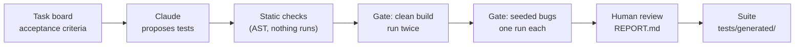

# ai-test-generation

`taskgen` sends the acceptance criteria on a task card to Claude, which proposes pytest tests for them. A gate keeps a proposed test only if it passes on the current build and fails on at least one deliberately broken build, and a person reviews it before it joins the suite.



## Why the gate exists

A generated test that passes proves only that it passes. `assert reply.text` passes whatever the agent says. A test counts once it has been shown to fail against a build with a known mistake in it.

So the gate runs every proposed test against the clean app twice, once with the other proposals and once on its own, then once under each of 12 seeded bugs. Each seeded bug is one realistic mistake behind `SEEDED_BUG=<name>`: the emergency check runs after the model, a date of birth is accepted only in ISO form, caller text goes into SSML unescaped. A test that passes clean and fails an assertion under at least one bug is `accepted`. One that no bug makes fail an assertion is `proves-nothing`. A crash under a bug (a `TypeError` in a step) is reported but does not count.

The model never sees the bug list. It is not in the prompt, the OpenAPI document or the harness guide, and `taskgen/context.py` refuses to send a context that names one. The gate's results go to the person reviewing, never back to the model.

## The sample board and app

Everything here is fictional. Fernhill Labs builds Front Desk, an AI voice agent that answers the phone for Brookside Family Clinic (Dr. Okafor, Dr. Lindqvist and Dr. Patel).

The board, `fernhill-front-desk`, lives on a self-hosted task app. FERN-1 explains it; FERN-2 to FERN-16 are tasks with 63 acceptance criteria, most in Given/then form, covering LLM behavior, safety, privacy, voice and reliability. `examples/fernhill-board.json` is a snapshot of it, written by `taskgen snapshot`.

Six cards are in Done, and `frontdesk/` implements them: FERN-2 verify the caller, FERN-3 book an appointment, FERN-4 emergencies and no medical advice, FERN-8 hand off to a person, FERN-11 speak dates and numbers, FERN-13 recording disclosure and opt-out. The other nine (prompt injection, transcript redaction, latency, model fallback, Spanish callers and more) are To Do or In Progress and not built.

The app is FastAPI and simulates calls as text. A caller turn is what speech recognition heard, with a confidence score, keypad digits or a barge-in flag. Each reply comes back as text and SSML. Every call gets its own copy of the clinic world, so tests run in parallel.

The model inside Front Desk is a deterministic stand-in, `ScriptedModel` (rule-based intent detection and templated replies), behind a `Model` protocol, so the app's tests are repeatable. Testing what a real model says is what an eval set is for (card FERN-14). This repository tests the system around the model: the rules that run before it, what happens when it is down, what reaches the caller and what is stored.

The reference suite in `tests/frontdesk/` has 162 tests. Every Done criterion has at least one, and every seeded bug has at least one test marked `@pytest.mark.catches("<bug>")`. `scripts/check_bugs_are_real.py` holds the suite to that: it passes on the clean build, and every test that claims a bug fails on an assertion under that bug.

Generated tests are written against `harness/`, a small pytest plugin: a `call` fixture with `say`, `press`, `record` and `appointments`, plus SSML helpers and the clinic's world data. `docs/HARNESS.md` documents it, and it is the guide the model gets.

## How the model is called

`taskgen/generate.py` uses the official `anthropic` SDK:

- Model `claude-opus-5-5`, or `TASKGEN_MODEL` if set. `output_config.effort` is set explicitly to `high`, since this model defaults to medium. There is no `thinking` key, so thinking is adaptive.
- `output_config.format` carries the JSON schema of `taskgen.schema.GeneratedTests`. `stop_reason` is checked before the content, so a `refusal` or a `max_tokens` cut-off is a failed result for that card, not a crash. The text is then validated with pydantic.
- The refusal fallback is on by default: `fallbacks="default"` with the beta `server-side-fallback-2026-07-01`, on the beta messages API. If the model declines a card on policy grounds, the API retries most such declines on a fallback model Anthropic picks for the refusal category (a `reasoning_extraction` decline is not retried), and the result records which model answered. `ClaudeGenerator(fallbacks=False)` turns it off.
- Requests stream through `client.beta.messages.stream(...)` and are read with `get_final_message()`. `max_tokens` is 32000.
- One system block marked `cache_control: {"type": "ephemeral"}` holds the instructions (`taskgen/prompt.py`, versioned), the Front Desk OpenAPI document as JSON with sorted keys, and `docs/HARNESS.md`. The card goes in the user message after it. Nothing volatile is in that prefix, and cards run one after another, so each card after the first can read the cache. An entry lives five minutes from the start of the last request that used it, and generation time counts against that, so a card whose generation runs past five minutes leaves the next card a cache write instead of a read. The cache-read tokens in the cost line show which happened.

The SDK retries connection errors, 429 and 5xx itself. A 400, 401, 403 or 404 stops the run, since it would fail every card, and so do credentials the SDK cannot load (for example an `ANTHROPIC_PROFILE` that does not exist). A rate limit, server error, timeout or connection error still there after the retries fails that card only.

`--mode replay`, the default, answers from `recordings/<card>.json` and makes no network call. A recording is keyed by a SHA-256 of the request (model, system block, messages, schema), so a changed prompt, guide, API or card makes it stale, and replay says which part changed. `--mode record` calls the API and writes the recording; `--mode live` calls it and keeps nothing.

Every result keeps its input, output, cache-read and cache-write tokens, and the reports turn them into an estimated cost at list prices: $4 input, $20 output, $0.20 cache read and $5 cache write per million tokens for Opus 5.5. List prices may change. Only Opus 5.5 is priced, so a run with a card answered by a fallback model shows "cost unknown". A card whose call failed counts no tokens and adds nothing.

`--mode canned` reads `fixtures/canned/` instead: four stand-ins in the output schema, written for the offline demo and for CI. Each carries `"_note": "Stand-in for a model response, written for the offline demo and to test the pipeline without an API key. Not model output."` They include, on purpose, good tests, a test that only checks a reply exists, one with a wrong expected value, two that break the rules, and one untestable criterion.

## What a proposed test goes through

1. Static checks (`taskgen/static_checks.py`) read the proposal's AST; nothing runs. A proposal is one `test_*` function, with a name no other proposal for the card has, and a `@pytest.mark.criterion("FERN-<n>/AC-<k>")` marker naming a real criterion of the card. It imports only from pytest, re, json, datetime and harness. It may not sleep, use `random`, start processes, or touch sockets, files or network clients, and nothing in it may depend on the wall clock (`datetime.now()`, `start_call(at=None)`, a `POST /calls` without `at`). It uses no test-only routes and no private names, and sets no attributes or module state, so nothing outlives the test. Every `assert` checks a value from the app, and none compares a value with itself. `all()` over the app's values is allowed only alongside another assertion on them, because it is true for an empty list. There is no skip or xfail, no `if`, `while` or `try`, and no `for` over values the app returns, since a loop over an empty list asserts nothing. Each failure has a reason a reviewer can act on; the module docstring lists every rule.
2. The gate (`taskgen/gate.py`) writes proposals to `proposed/<card>/test_<card>_<k>.py`. pytest runs them in subprocesses, each starting its own Front Desk: the clean build once with every proposal together and once per proposal on its own, then each seeded bug with the same set of proposals as the first clean run. A test whose result changes when it runs alone depends on another test and is flaky. Only a failed assertion under a bug (including a `pytest.raises` that saw no error) counts as a catch. Each run carries a canary test that checks the app answered, so a build that failed to start cannot turn every test into proves-nothing. Only cards in Done are run.
3. The reports (`taskgen/report.py`) are `proposed/<card>/REPORT.md` per card and `proposed/RUN.md` for the run. They show each criterion with its tests and verdicts, the bugs each accepted test caught and how it failed, untestable criteria with reasons, criteria left with no accepted test, and the cost line when the model was used.
4. A person reviews. `taskgen accept <card>` copies accepted tests into `tests/generated/<card>/`, each with a header naming the card, the criterion and the bugs it caught. It refuses any test that is not accepted, and any proposed file edited after the gate. Nothing else writes there.

| Verdict | Meaning |
|---|---|
| `accepted` | passes the clean build twice and fails an assertion under at least one seeded bug |
| `proves-nothing` | passes the clean build, and no seeded bug makes an assertion in it fail |
| `fails-on-clean` | fails on the clean build: the test or the app is wrong, and a person decides which |
| `flaky` | the two clean runs (with the other proposals, and on its own) disagree |
| `rejected` | failed the static checks, so it never ran |
| `not-built-yet` | the card is not in Done; the test is written for review and not run |

### Example report from the canned run

This is real output from `taskgen generate --mode canned --source file` then `taskgen gate`. The tests are the canned stand-ins, not model output. From `proposed/RUN.md`, with the card links removed:

| Card | List | Proposed | accepted | proves-nothing | fails-on-clean | flaky | rejected | not-built-yet | Untestable |
|---|---|---|---|---|---|---|---|---|---|
| FERN-2 | Done | 6 | 3 | 2 | 1 | 0 | 0 | 0 | 0 |
| FERN-4 | Done | 5 | 2 | 2 | 0 | 0 | 1 | 0 | 0 |
| FERN-8 | Done | 6 | 5 | 0 | 0 | 0 | 1 | 0 | 0 |
| FERN-11 | Done | 5 | 4 | 1 | 0 | 0 | 0 | 0 | 1 |
| **Total** |  | 22 | 14 | 5 | 1 | 0 | 2 | 0 | 1 |

CI checks these counts. Flaky and not-built-yet cannot occur here, because the app is deterministic and all four canned cards are in Done; `tests/taskgen/test_gate.py` produces both on purpose. The 14 accepted tests catch 9 of the 12 seeded bugs. `morning-includes-noon`, `double-booking` and `disclosure-skipped-on-barge-in` belong to FERN-3 and FERN-13, which have no canned file.

From `proposed/FERN-2/REPORT.md`, one criterion with an accepted test and a wrong one:

```markdown
## AC-2 · Given the name and date of birth match one patient record, then Front Desk confirms the caller is verified and can tell them that patient's next appointment.

**`test_verified_caller_hears_their_own_next_appointment`** · accepted · caught `other-patient-leak`

- Intent: Fails if a verified caller is not confirmed or hears an appointment other than their own.
- Why: Passes on the clean build twice and fails under 1 of 12 seeded bugs.
- File: `FERN-2/test_FERN-2_2.py`
- Under `other-patient-leak`: `assert "Thanks, Maria, you're verified. Your next appointment is with Dr. Patel on Tuesday, October 20th at 9:30 AM." == "Thanks, Maria, you're verified. Your next appointment is with Dr. Lindqvist on Thursday, October 22nd at 2 PM."`

**`test_verified_caller_hears_the_appointment_time`** · fails-on-clean

- Intent: Fails if a verified caller asking later is not told the time of their next appointment.
- Why: Fails on the clean build: failed (AssertionError: assert 'Your next appointment is with Dr. Okafor on Tuesday, October 27th at 9 AM.' == 'Your next appointment is with Dr. Okafor on Tuesday, October 27th at 9:00 AM.'). The test or the app is wrong; a person decides which.
- File: `FERN-2/test_FERN-2_3.py`
```

The fails-on-clean test is wrong, not the app: the harness guide says a time on the hour is spoken "9 AM". The two rejected tests sleep and use `random`; their reports show the code and each rule they broke.

## Run it offline

Python 3.12 or later. No API key, and no network after the install.

```bash
python3 -m venv .venv && .venv/bin/pip install -e ".[dev]"
. .venv/bin/activate

pytest -n auto                                # 516 tests; the gate's own tests start real pytest runs
python scripts/check_bugs_are_real.py         # every seeded bug fails every test that claims it
ruff check . && ruff format --check .

taskgen generate --mode canned --source file  # canned stand-ins for FERN-2, FERN-4, FERN-8, FERN-11
taskgen gate                                  # clean build together and per test, then the 12 seeded bugs
taskgen report --quiet --expect accepted=14,proves-nothing=5,fails-on-clean=1,rejected=2
taskgen report                                # rebuild the reports and print proposed/RUN.md
taskgen accept FERN-8 --tests test_pressing_zero_transfers_in_that_turn
pytest tests/generated                        # the accepted test, now part of the suite
taskgen comment FERN-8                        # prints the comment for the card; posts nothing
```

Measured on a 4-core machine: the full suite took 1 to 2.5 minutes, the bug check about 40 s, and `taskgen gate` on the canned cards 30 to 50 s (it starts 33 pytest processes: one clean run with every test, one per test on its own, and one per seeded bug).

More:

```bash
taskgen generate --mode canned --cards FERN-8   # one card
taskgen gate --bug transfer-asks-why            # one seeded bug instead of twelve
SEEDED_BUG=transfer-asks-why pytest tests/frontdesk/test_fern8_handoff.py   # 11 of 15 fail
uvicorn frontdesk.main:app --port 8000          # the app on its own; POST /calls starts a call
```

`taskgen generate` with no `--mode` replays recordings. `recordings/` holds no recording until a live run is recorded, so it stops and prints the command to record one.

## Record a live run with your own key

This has not been run in this repository: it calls the Anthropic API and is billed to your key.

```bash
ANTHROPIC_API_KEY=... taskgen generate --mode record --source board --board fernhill-front-desk
taskgen gate
```

`--source board` reads the live board, so it also needs `TASKS_URL`, `CF_ACCESS_CLIENT_ID` and `CF_ACCESS_CLIENT_SECRET`. Without them, `ANTHROPIC_API_KEY=... taskgen generate --mode record` reads the same cards from `examples/fernhill-board.json`; the request is the same either way, so the recordings are interchangeable. Commit `recordings/` and `taskgen generate` replays them for anyone, without a key and at no cost. `taskgen comment <card> --yes` then posts a card's summary to the board. It is the only write to the board, it names no seeded bug, and it has not been run here either.

The cost below is an estimate, not a measurement, since no live run has been recorded yet. The cached system block is 37,603 characters (instructions 7,163, OpenAPI 11,386, harness guide 18,996), taken here as about 12,000 tokens; a card message is 900 to 1,500 characters. Output is the unknown, because thinking is billed as output and its length at effort high is known only after a run. Assuming 5,000 to 15,000 output tokens per card, at the list prices above:

| Run | Estimate |
|---|---|
| One card (pays the cache write) | about $0.16 to $0.36 |
| The six Done cards | about $0.70 to $1.90 |
| All 15 cards with criteria | about $1.60 to $4.60 |

Output tokens are almost all of it. After a real run, the cost line in `proposed/RUN.md` gives the measured tokens and cost.

## Point it at another board

The board API it reads is `GET {TASKS_URL}/api/v1/boards/{slug}` for the lists (each with a `role` of todo, doing or done) and their cards, then `GET /api/v1/cards/{ref}` for each card's checklists. The checklist named "Acceptance criteria" holds the criteria in order, so its first item is AC-1; cards without one are skipped. Auth is a Cloudflare Access service token in `CF_ACCESS_CLIENT_ID` and `CF_ACCESS_CLIENT_SECRET`. Leave both unset for a board without Access.

For another Front Desk board, run `taskgen snapshot --board <slug> --out board.json`, then `ANTHROPIC_API_KEY=... taskgen generate --mode record --snapshot board.json` (or `--source board --board <slug>` in place of `--snapshot`; both need a key), then `taskgen gate`. Only cards in a list with the role `done` are gated.

For another task app, answer those two GETs, or write a snapshot in the format of `examples/fernhill-board.json` yourself (a criterion can be a plain string).

For another product, replace what is wired to Front Desk: `frontdesk/` (the app and its `bugs.py` catalog), `harness/` and `docs/HARNESS.md`, then the instructions in `taskgen/prompt.py`, which name Front Desk.

## Limits

- The seeded bugs are a fixed list of twelve. Accepted means the test was shown to fail against one of them, not that it checks its whole criterion. Two canned tests are accepted only through a precondition. FERN-11/AC-3 is accepted because `transfer-asks-why`, a FERN-8 bug, breaks the callback flow it goes through, though no seeded bug removes the say-as wrapping it is about. FERN-8/AC-3 is accepted because its first assertion, `reply.transferred is True`, fails under `transfer-asks-why`, though no seeded bug touches the handoff summary its other assertions check. Mutation testing tools such as mutmut widen the bug set mechanically.
- The static checks are not a sandbox. They reject the ways a test is most likely to depend on the clock or on another test, and running each test on its own catches a test that passes only next to the others. A determined test could still find other channels, so a person reads every accepted test.
- A correct test can be proves-nothing when no seeded bug touches what it checks, as with FERN-4 AC-3 and AC-4 here. The fix is a seeded bug for that behavior, or a gap accepted knowingly.
- The scripted model is not the real one. It understands the phrasings listed in `docs/HARNESS.md`, so a generated test phrased some other way can fail on the clean build, and a person reads the failure.
- Recordings depend on the exact request. An upgrade of FastAPI or pydantic that changes the generated OpenAPI document makes them stale, and replay says the system block changed.
- Nothing here measures the model yet. The canned run shows the pipeline works, not how good the model's tests are; that takes a recorded run.
- Cards outside Done are not built, so their tests come back `not-built-yet` and are never run.
- Accepted tests are kept exactly as the gate ran them, so ruff does not reformat `tests/generated/`. `tests/taskgen/test_generated_suite.py` holds every file there to its header and the static checks instead.

## Layout

```
frontdesk/                 the sample system under test: FastAPI app, scripted model, bugs.py
harness/                   the pytest plugin and client generated tests are written against
docs/HARNESS.md            the harness guide given to the model (and to people)
taskgen/
  cards.py                 Card and Criterion
  sources.py               TaskBoardSource (REST API) and FileSource (snapshot JSON)
  context.py               the cached context block, checked for leaks
  prompt.py                the instructions, versioned
  schema.py                the output models
  generate.py              ClaudeGenerator, cassettes, CannedGenerator, FakeGenerator
  static_checks.py         AST checks on proposed tests
  gate.py                  clean and seeded-bug runs, verdicts
  report.py                REPORT.md, RUN.md, the card comment
  accept.py                the human gate into tests/generated/
  cli.py                   the taskgen command
examples/fernhill-board.json   the board snapshot
fixtures/canned/           stand-ins for the offline demo (labeled, not model output)
recordings/                live recordings (empty until one is recorded)
proposed/                  gate output (gitignored)
scripts/check_bugs_are_real.py
tests/
  frontdesk/               the reference suite for the sample app
  taskgen/                 tests of the generator, sources, checks, gate, reports and CLI
  generated/               accepted generated tests (empty until some are accepted)
.github/workflows/ci.yml   lint, tests on 3.12 and 3.14, bugs are real, canned pipeline
```

CI runs on GitHub-hosted runners with read-only permissions. No job has an API key or calls the model.

## Related

[qa-automation-showcase](https://github.com/mdanifo/qa-automation-showcase): the same rule, applied to a different test suite.

## About

Mike Danifo, a QA automation engineer with twenty years in software quality. [danifo.dev](https://danifo.dev) · [LinkedIn](https://www.linkedin.com/in/mdanifo)

MIT license; see [LICENSE](LICENSE).
