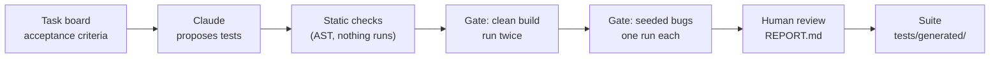

# ai-test-generation

`taskgen` sends the acceptance criteria on a task card to Claude and asks for pytest tests. A gate keeps a proposed test only if it passes on the current build and fails on at least one build with a known bug seeded into it. A person reviews what survives before it joins the suite.



## Why the gate

A generated test that passes has shown only that it passes. `assert reply.text` is green whatever the agent says. A test earns its place once it has failed against a build with a known mistake in it.

The gate runs each proposal against the clean app twice (with the other proposals, then on its own) and then once under each of 12 seeded bugs. A seeded bug is one realistic mistake behind `SEEDED_BUG=<name>`: the emergency check runs after the model, a date of birth is accepted only in ISO form, caller text goes into SSML unescaped. A test that passes clean and fails an assertion under at least one bug is `accepted`. One that no bug can make fail is `proves-nothing`. A crash under a bug (a `TypeError` in a step) is reported but does not count as a catch.

The bug list stays out of the prompt. `taskgen/context.py` refuses to build a system block that names a seeded bug, and the gate's results go to the reviewer, not back to the model.

## The sample board and app

Everything here is fictional. Fernhill Labs builds Front Desk, an AI voice agent that answers the phone for Brookside Family Clinic (Dr. Okafor, Dr. Lindqvist and Dr. Patel).

The board, `fernhill-front-desk`, lives on a self-hosted task app; `examples/fernhill-board.json` is a snapshot of it. FERN-1 describes the product. FERN-2 to FERN-16 are tasks with 63 acceptance criteria, mostly in Given/then form, covering LLM behavior, safety, privacy, voice and reliability. Six cards are Done and `frontdesk/` implements them: verify the caller (FERN-2), book an appointment (FERN-3), emergencies and no medical advice (FERN-4), hand off to a person (FERN-8), speak dates and numbers (FERN-11), recording disclosure and opt-out (FERN-13). The other nine (prompt injection, transcript redaction, latency, model fallback, Spanish callers and more) are To Do or In Progress and not built.

The app is FastAPI and simulates calls as text: a caller turn is what speech recognition heard, with a confidence score, keypad digits or a barge-in flag, and each reply comes back as text and SSML. Every call gets its own copy of the clinic world, so tests run in parallel.

The model inside Front Desk is a deterministic stand-in, `ScriptedModel` (rule-based intent detection and templated replies), behind a `Model` protocol. What a real model would say is an eval-set question (card FERN-14). This repository tests the system around the model: the rules that run before it, what happens when it is down, what reaches the caller and what is stored.

`tests/frontdesk/` is the reference suite. Every Done criterion has at least one test, and every seeded bug has at least one test marked `@pytest.mark.catches("<bug>")`. `scripts/check_bugs_are_real.py` holds it to that: the suite passes on the clean build, and every test that claims a bug fails on an assertion under it.

Generated tests are written against `harness/`, a small pytest plugin: a `call` fixture with `say`, `press`, `record` and `appointments`, SSML helpers and the clinic's world data. `docs/HARNESS.md` documents it and is the guide the model gets.

## Run it offline

Python 3.12 or later. No API key, and no network after the install.

```bash
python3 -m venv .venv && .venv/bin/pip install -e ".[dev]"
. .venv/bin/activate

pytest -n auto                                # a couple of minutes; the gate's tests start real pytest runs
python scripts/check_bugs_are_real.py         # every seeded bug fails every test that claims it
ruff check . && ruff format --check .

taskgen generate --mode canned --source file  # canned stand-ins for FERN-2, FERN-4, FERN-8, FERN-11
taskgen gate                                  # clean build together and per test, then the 12 seeded bugs
taskgen report --quiet --expect accepted=14,proves-nothing=5,fails-on-clean=1,rejected=2
taskgen report                                # rebuild the reports and print proposed/RUN.md
taskgen accept FERN-8 --tests test_pressing_zero_transfers_in_that_turn
pytest tests/generated                        # the accepted test, now part of the suite
taskgen comment FERN-8                        # prints the comment for the card; posts nothing
```

`taskgen gate` on the canned cards takes about a minute on four cores. It starts one pytest process per clean run (one with every test, then one per test on its own) and one per seeded bug.

More:

```bash
taskgen generate --mode canned --cards FERN-8   # one card
taskgen gate --bug transfer-asks-why            # one seeded bug instead of twelve
SEEDED_BUG=transfer-asks-why pytest tests/frontdesk/test_fern8_handoff.py   # 11 of 15 fail
uvicorn frontdesk.main:app --port 8000          # the app on its own; POST /calls starts a call
```

`--mode canned` reads `fixtures/canned/`: four stand-ins in the output schema, written for the offline demo and for CI, each labeled `"_note": "... Not model output."`. On purpose they include good tests, a test that only checks a reply exists, one with a wrong expected value, two that break the rules, and one untestable criterion. From `proposed/RUN.md` after the run above:

| Card | List | Proposed | accepted | proves-nothing | fails-on-clean | flaky | rejected | not-built-yet | Untestable |
|---|---|---|---|---|---|---|---|---|---|
| FERN-2 | Done | 6 | 3 | 2 | 1 | 0 | 0 | 0 | 0 |
| FERN-4 | Done | 5 | 2 | 2 | 0 | 0 | 1 | 0 | 0 |
| FERN-8 | Done | 6 | 5 | 0 | 0 | 0 | 1 | 0 | 0 |
| FERN-11 | Done | 5 | 4 | 1 | 0 | 0 | 0 | 0 | 1 |
| **Total** |  | 22 | 14 | 5 | 1 | 0 | 2 | 0 | 1 |

CI checks these counts. The fails-on-clean test expects "9:00 AM" where the guide says a time on the hour is spoken "9 AM", so the test is wrong and the app is right; `proposed/FERN-2/REPORT.md` shows the assertion. The two rejected tests sleep and use `random`, and their reports show the code and the rule each broke. Flaky and not-built-yet cannot happen here (the app is deterministic and all four cards are Done); `tests/taskgen/test_gate.py` produces both on purpose.

`taskgen generate` with no `--mode` replays `recordings/`. That directory is empty until someone records a live run, so it stops and prints the command to record one.

## Record a live run with your own key

Not done in this repository yet: it calls the Anthropic API and is billed to your key.

```bash
ANTHROPIC_API_KEY=... taskgen generate --mode record --source board --board fernhill-front-desk
taskgen gate
```

`--source board` reads the live board and needs `TASKS_URL`, `CF_ACCESS_CLIENT_ID` and `CF_ACCESS_CLIENT_SECRET`. Without them, `taskgen generate --mode record` reads the same cards from `examples/fernhill-board.json`; the request is the same either way. Commit `recordings/` and `taskgen generate` replays them for anyone, with no key and no cost. `taskgen comment <card> --yes` posts a card's summary to the board. It is the only write to the board and names no seeded bug.

Cost: the cached system block (instructions, OpenAPI document, harness guide) is about 12,000 tokens and a card message is a few hundred. Output dominates, since thinking is billed as output. At list prices expect well under a dollar per card and a few dollars for all 15, then read the real number off the cost line in `proposed/RUN.md`.

## How the model is called

`taskgen/generate.py` uses the `anthropic` SDK. The short version:

- Model `claude-opus-5-5` (`TASKGEN_MODEL` overrides it), `output_config.effort` set to `high`, no `thinking` key.
- Structured output: `output_config.format` carries the JSON schema of `taskgen.schema.GeneratedTests`, and pydantic validates the text on the way back. `stop_reason` is checked first, so a refusal or a `max_tokens` cut-off is a failed card rather than a crash.
- The server-side refusal fallback (`fallbacks="default"` with the `server-side-fallback-2026-07-01` beta) is on; `ClaudeGenerator(fallbacks=False)` turns it off. The result records which model answered.
- Streaming, `max_tokens` 32000.
- One system block marked `cache_control: {"type": "ephemeral"}` holds the instructions, the OpenAPI document and the harness guide; the card is the user message. Cards run one after another so each can read the cache the previous one wrote, and the cache-read tokens on the cost line tell you whether it did.

Errors: a 400, 401, 403 or 404, or credentials the SDK cannot load, would fail every card, so they stop the run. A rate limit, server error or network failure still there after the SDK's own retries fails that card only.

Recordings are keyed by a SHA-256 of the request (model, system block, messages, schema). Change the prompt, the guide, the API or the card and replay says which part moved and how to re-record.

## What a proposed test goes through

1. Static checks (`taskgen/static_checks.py`) read the AST; nothing runs. One `test_*` function with a `@pytest.mark.criterion("FERN-<n>/AC-<k>")` marker, imports from pytest, re, json, datetime and harness only, no sleeps, randomness, files, network, clock reads, private names, skips or control flow in the body, and at least one assert on a value from the app. The module docstring lists every rule with the reason it gives a reviewer.
2. The gate (`taskgen/gate.py`) writes proposals to `proposed/<card>/` and runs them in pytest subprocesses, each with its own Front Desk: the clean build with every proposal, the clean build once per proposal on its own, then each seeded bug. Every run carries a canary test, so a build that fails to start cannot turn the proposals into proves-nothing. Only Done cards run.
3. The reports (`taskgen/report.py`): `proposed/<card>/REPORT.md` per card and `proposed/RUN.md` for the run, with each criterion, its tests and verdicts, the bugs each accepted test caught and how it failed, untestable criteria, criteria left uncovered, and the cost line.
4. `taskgen accept <card>` copies accepted tests into `tests/generated/<card>/`, each with a header naming the card, the criterion and the bugs caught. It refuses anything not accepted and any proposed file edited after the gate ran.

| Verdict | Meaning |
|---|---|
| `accepted` | passes the clean build twice and fails an assertion under at least one seeded bug |
| `proves-nothing` | passes the clean build, and no seeded bug makes an assertion in it fail |
| `fails-on-clean` | fails on the clean build: the test or the app is wrong, and a person decides which |
| `flaky` | the two clean runs (with the other proposals, and on its own) disagree |
| `rejected` | failed the static checks, so it never ran |
| `not-built-yet` | the card is not in Done; the test is written for review and not run |

## Point it at another board

The board API is `GET {TASKS_URL}/api/v1/boards/{slug}` for the lists (each with a `role` of todo, doing or done) and their cards, then `GET /api/v1/cards/{ref}` for each card's checklists. The checklist named "Acceptance criteria" holds the criteria in order, so its first item is AC-1; cards without one are skipped. Auth is a Cloudflare Access service token in `CF_ACCESS_CLIENT_ID` and `CF_ACCESS_CLIENT_SECRET`; leave both unset for a board without Access.

For another Front Desk board: `taskgen snapshot --board <slug> --out board.json`, then `ANTHROPIC_API_KEY=... taskgen generate --mode record --snapshot board.json`, then `taskgen gate`. For another task app, answer those two GETs or write a snapshot in the format of `examples/fernhill-board.json` (a criterion can be a plain string). For another product, replace what is wired to Front Desk: `frontdesk/` with its `bugs.py` catalog, `harness/` and `docs/HARNESS.md`, and the instructions in `taskgen/prompt.py`.

## Limits

- Twelve seeded bugs is a small set. Accepted means the test failed against one of them, which is weaker than checking its whole criterion: two canned tests (FERN-11/AC-3 and FERN-8/AC-3) pass the gate because `transfer-asks-why` breaks a step they go through, with no bug touching the behavior they are about. A mutation testing tool such as mutmut would widen the set mechanically.
- The static checks are not a sandbox. They catch the usual ways a test depends on the clock or on another test, and the solo run catches a test that only passes next to the others. A person still reads every accepted test.
- A correct test can be proves-nothing when no seeded bug touches what it checks (FERN-4 AC-3 and AC-4 here). Add a bug for that behavior or accept the gap knowingly.
- The scripted model understands the phrasings in `docs/HARNESS.md`. A generated test phrased some other way fails on the clean build, and a person reads the failure.
- Recordings depend on the exact request. A FastAPI or pydantic upgrade that changes the OpenAPI document makes them stale.
- Nothing here measures the model yet. The canned run shows the pipeline works, not how good the model's tests are.
- Accepted tests are kept byte for byte as the gate ran them, so ruff skips `tests/generated/`; `tests/taskgen/test_generated_suite.py` holds every file there to its header and the static checks.

## Layout

```
frontdesk/                 the sample system under test: FastAPI app, scripted model, bugs.py
harness/                   the pytest plugin and client generated tests are written against
docs/HARNESS.md            the harness guide given to the model (and to people)
taskgen/
  cards.py                 Card and Criterion
  sources.py               TaskBoardSource (REST API) and FileSource (snapshot JSON)
  context.py               the cached context block, checked for leaks
  prompt.py                the instructions, versioned
  schema.py                the output models
  generate.py              ClaudeGenerator, cassettes, CannedGenerator, FakeGenerator
  static_checks.py         AST checks on proposed tests
  gate.py                  clean and seeded-bug runs, verdicts
  report.py                REPORT.md, RUN.md, the card comment
  accept.py                the human gate into tests/generated/
  cli.py                   the taskgen command
examples/fernhill-board.json   the board snapshot
fixtures/canned/           stand-ins for the offline demo (labeled, not model output)
recordings/                live recordings (empty until one is recorded)
proposed/                  gate output (gitignored)
scripts/check_bugs_are_real.py
tests/
  frontdesk/               the reference suite for the sample app
  taskgen/                 tests of the generator, sources, checks, gate, reports and CLI
  generated/               accepted generated tests (empty until some are accepted)
.github/workflows/ci.yml   lint, tests on 3.12 and 3.14, bugs are real, canned pipeline
```

CI runs on GitHub-hosted runners with read-only permissions. No job has an API key or calls the model.

## Related

[qa-automation-showcase](https://github.com/mdanifo/qa-automation-showcase): the same rule, applied to a different test suite.

## About

Mike Danifo, a QA automation engineer with twenty years in software quality. [danifo.dev](https://danifo.dev) · [LinkedIn](https://www.linkedin.com/in/mdanifo)

MIT license; see [LICENSE](LICENSE).
